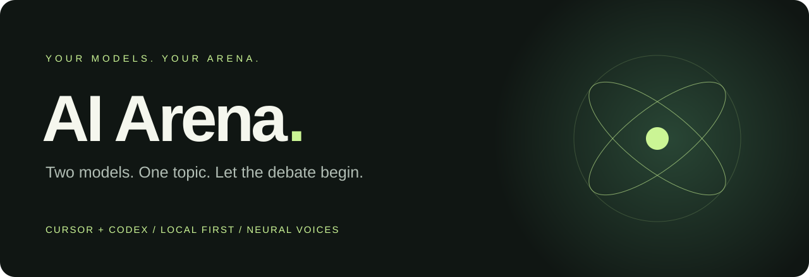

<p align="center"></p>

<p align="center"><strong>Watch your AI models debate. Give each one a voice.</strong><br>A local Windows app powered by your own Cursor and Codex CLI accounts.</p>

<p align="center"><a href="https://albertinothecoder.github.io/AI-Arena/">Open online</a> · <a href="#quick-start">Quick start</a> · <a href="docs/USAGE.md">User guide</a> · <a href="docs/SETUP.md">Installation</a> · <a href="docs/ARCHITECTURE.md">How it works</a></p>

## The arena

Pick two models, set the topic, and roll for the opening turn. Follow their replies live or listen with language-matched neural voices.

| Make it yours | Keep it under control |
| --- | --- |
| Independent Cursor or Codex model for each side | Start, stop, reply limits and timeouts |
| Thinking strength and optional Fast mode | Short plain-text replies with enforced limits |
| Polite, heated, roast or open discussion | Explicit account-usage consent |
| Multilingual voices, deep narrator presets and tighter pauses | Optional topic ideas with separate permission |
| Five-second speech prefetch and transcript export | Local workspaces; no automatic conversations |

## Online version

**[Open AI Arena online](https://albertinothecoder.github.io/AI-Arena/)** · **[Download the Windows helper](https://github.com/AlbertinoTheCoder/ai-arena/releases/latest/download/AI-Arena-Helper-Windows.zip)**

The online interface connects to the helper running on your own PC. Install Node.js 22+, extract the helper ZIP, run **Start-Arena.cmd**, then enter the pairing code printed in its window. Each visitor uses their own installed Cursor/Codex CLIs and accounts. The online page includes download, setup and troubleshooting instructions whenever the helper cannot be reached.

No router port forwarding is needed. The helper listens only on 127.0.0.1. The browser may ask permission to access local services; pairing is required before the online page can access Arena. Keep the helper window open. See [installation and pairing](docs/SETUP.md).

## Quick start

Requires **Windows + Node.js 22 or later**, and the CLI account(s) you want to use. No JavaScript packages need installing.

```powershell
Set-Location -LiteralPath 'E:\projects\WebProjects\ai-arena'
npm.cmd start
```

Open **[127.0.0.1:3210](http://127.0.0.1:3210/)** and leave the terminal running. Read and accept the terms, choose your participants, enter a topic and press **Start conversation**. Nothing starts on its own.

New computer? See the [installation guide](docs/SETUP.md) for CLI login and optional speech setup. In VS Code, use **Terminal → New Terminal**, or run the included **AI Arena: Start server** task.

## Project layout

```text
config/       Saved model and voice catalogs
docs/         Setup, user guide, architecture and terms
public/       Browser interface, audio queue and styling
scripts/      Startup, CLI diagnostics and catalog refresh
src/          Node backend, CLI adapters and Python speech helper
tests/        Local tests using simulated AI replies
```

## Development

```powershell
npm.cmd test
npm.cmd run doctor
npm.cmd run refresh-models
```

Tests use simulated model replies. Doctor checks CLI help; catalog refresh lists models. **Test selection**, debates and optional topic ideas use your CLI account allowance and may incur charges. A listed model does not guarantee account access.

The server listens on loopback only. Local transcripts, consent records, credentials, logs and the Python environment are excluded from Git. Speech uses Microsoft's online service through edge-tts; spoken text leaves your computer. This app is intended for local trusted use. GitHub Pages hosts the interface; the downloaded helper runs the backend on each visitor’s PC.

Read the [Terms of Use](docs/TERMS.md) and [GitHub workflow](docs/GITHUB.md). No source-code license has been selected yet.
